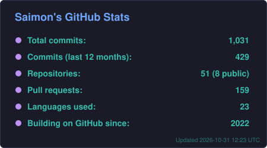
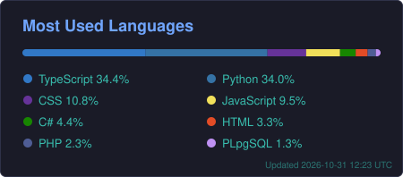
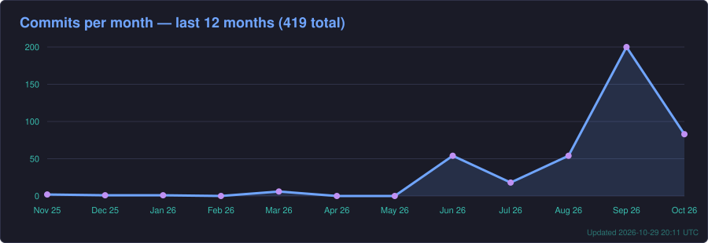

# 👋 Hi, I'm Saimon Gerardo Vargas Porras!

🌐 **English | [Versión en Español Abajo ⬇️](#espanol)**

**Software Engineer · Full Stack Developer** from Costa Rica. I build systems that reach production: I led a microservices platform for **Smith & Nephew** (Fortune 500) that serves **10,000+ concurrent users**, cut a document-processing pipeline from **60 minutes to under 5 (−92%)**, and integrated **4 AI providers** with automatic failover. Bachelor's in Software Engineering (UTN, SINAES-accredited) and member of Costa Rica's professional IT association (**CPIC No. 12969**).

---

## 📫 How to reach me:

📞 **Phone:** [+506 8861 4654](tel:+50688614654)  
📍 San Carlos, Alajuela, Costa Rica

---

## 🌎 Languages

- Spanish (Native)
- English (B2 — Professional working proficiency · Associate degree in English as a Foreign Language, UTN)

---

## 💻 Programming Languages

---

## 🛠️ Tools & Frameworks

---

## 💼 Work Experience

### **Full Stack Developer | Bizflow (EZ Forms) (01/2025 - 12/2025)**

- Led the development of **ProduccionHxH** for **Smith & Nephew** (Fortune 500, medical devices): a React frontend and **3 Docker microservices** (Python/FastAPI, PostgreSQL) used by **10,000+ concurrent users** to log production in real time.
- Optimized the microservices under real load after launch (queries, service-to-service communication, processing).
- Designed a **centralized financial system** consolidating income, expenses and reports for **3 companies**.
- Built an **n8n-style workflow automation engine** (configurable no-code/low-code flows) and several inter-department CRUD modules.
- Coordinated QA with the Project Manager: technical reviews and deliverable validation before every release.
- 🏅 Recognized as one of the **top 3 performers on the team in Q1 2025**.

### **Full Stack Developer — Internship | Subaxa (09/2025 - 12/2025)**

- Designed a **13-step ETL pipeline** that cut legal-bulletin processing from 30–60 min to **under 5 min (−92%)**.
- Integrated **OpenAI, Gemini, Groq and Ollama** with automatic failover and a data-enrichment pipeline.
- Implemented **JWT authentication and multi-role access control** with file storage on AWS S3 (Laravel · Next.js · GraphQL · PostgreSQL · Redis).
- Reached **98.5% test coverage** with Pest PHP and PHPStan level 8.

### **JavaScript Instructor | Universidad Metropolitana Castro Carazo (06/2026 - 09/2026)**

- Designed and taught *Introduction to JavaScript* to **21 Claro Costa Rica employees** (3 groups, fully remote): ECMAScript, DOM, events, fetch/APIs and project-based learning.

### **Co-founder & Board President | CODE-IN, Universidad Técnica Nacional (01/2023 - 12/2024)**

- Co-founded the first student tech community at UTN San Carlos to complete a research project, and chaired its board.
- Founded and led the **Web area**: planned, documented and delivered the website for the Aguas Zarcas Association with React and a Scrum-inspired process (code reviews, weekly follow-ups, client meetings).
- Worked on the **Aguas Zarcas Meteorite VR Museum** and its video game (Godot/GDScript): 3D modeling, map prototype, characters and story.

---

## 🚀 Featured Projects

### **[MeloVault](https://github.com/Saimon1520/melovault)** · [Download APK](https://github.com/Saimon1520/melovault/releases/latest)

Free, ad-free local music player for Android.  
  

### **DualCast** 🔒 *private repo*

Remote desktop for Linux/Wayland that streams **both monitors** to any browser over WebRTC with NVIDIA NVENC hardware encoding.  
  

### **mih** 🔒 *private repo*

My own AI coding agent: engine, web dashboard and evaluation bench, running on local models (Ollama) and free-tier APIs.  
 

### **[Odín](https://github.com/Saimon1520/odin-app)** · [Download APK](https://github.com/Saimon1520/odin-app/releases/latest)

Android app for my personal voice assistant, connected over HTTPS and Tailscale to my own server.  
 

### **[receteria.com](https://receteria.com)** · live

Website in production, self-hosted on my own Debian server with **continuous deployment** from GitHub webhooks.  
  

### **[Secure Login](https://github.com/Saimon1520/Proyecto-2_Seguridad)**

Authentication with NextAuth, BCrypt hashing, Prisma (SQL-injection safe) and lockout after failed attempts.  
  

### **[PruebaJR](https://github.com/Saimon1520/prueba-jr)** · [Live demo](https://prueba-jr.vercel.app)

Posts, comments and albums CRUD consuming a REST API.  
 

---

## 🏆 Highlights

-38bdae?style=for-the-badge&labelColor=1a1b27)

---

## 📚 Education

- 🎓 Bachelor's Degree in Software Engineering — Universidad Técnica Nacional (2024-2025, degree conferred 2026 · SINAES-accredited)
- 🎓 Associate Degree in Information Technology — Universidad Técnica Nacional (2021-2024 · SINAES-accredited)
- 🎓 Associate Degree in English as a Foreign Language — Universidad Técnica Nacional (2021-2024)
- 📜 Member of the Costa Rican Association of IT Professionals (CPIC) — No. 12969
- 📜 Ministry of Public Education (MEP) technical teaching qualification VT3: software development, networks, cybersecurity, cloud and AI

---

## 📊 GitHub Stats

Generated from all my repositories, including private ones (most of my work is private).

---

## 🔥 GitHub Streak

---

## 📈 Activity Graph

---

## 🚀 Profile Visits

---

# 👋 ¡Hola, soy Saimon Gerardo Vargas Porras!

🌐 **Español | [English Version Above ⬆️](#english)**

**Ingeniero del Software · Desarrollador Full Stack** de Costa Rica. Construyo sistemas que llegan a producción: lideré una plataforma de microservicios para **Smith & Nephew** (Fortune 500) que atiende a **más de 10 000 usuarios concurrentes**, reduje un pipeline de procesamiento de documentos de **60 minutos a menos de 5 (−92 %)** e integré **4 proveedores de IA** con conmutación automática. Bachiller en Ingeniería del Software (UTN, acreditada por SINAES) e incorporado al **CPIC (N.º 12969)**.

---

## 📫 ¿Cómo contactarme?

📞 **Teléfono:** [+506 8861 4654](tel:+50688614654)  
📍 San Carlos, Alajuela, Costa Rica

---

## 🌎 Idiomas

- Español (Nativo)
- Inglés (B2 — Competencia profesional · Diplomado en Inglés como Lengua Extranjera, UTN)

---

## 💻 Lenguajes de Programación

---

## 🛠️ Herramientas y Frameworks

---

## 💼 Experiencia Laboral

### **Desarrollador Full Stack | Bizflow (EZ Forms) (01/2025 - 12/2025)**

- Lideré el desarrollo de **ProduccionHxH** para **Smith & Nephew** (Fortune 500, dispositivos médicos): frontend en React y **3 microservicios en Docker** (Python/FastAPI, PostgreSQL) que usan **más de 10 000 usuarios concurrentes** para registrar la producción en tiempo real.
- Optimicé los microservicios bajo carga real después del lanzamiento (consultas, comunicación entre servicios y procesamiento).
- Diseñé un **sistema financiero centralizado** que consolida ingresos, egresos y reportes de **3 empresas**.
- Construí un **motor de automatización de flujos al estilo de n8n** (no-code/low-code) y varios módulos CRUD interdepartamentales.
- Coordiné el QA con el Project Manager: revisiones técnicas y validación de entregables antes de cada release.
- 🏅 Reconocido entre los **3 mejores desempeños del equipo en el Q1 2025**.

### **Desarrollador Full Stack — Práctica profesional | Subaxa (09/2025 - 12/2025)**

- Diseñé un **pipeline ETL de 13 pasos** que redujo el procesamiento de boletines legales de 30–60 min a **menos de 5 min (−92 %)**.
- Integré **OpenAI, Gemini, Groq y Ollama** con conmutación automática y un pipeline de enriquecimiento de datos.
- Implementé **autenticación JWT y control de acceso multirrol** con almacenamiento en AWS S3 (Laravel · Next.js · GraphQL · PostgreSQL · Redis).
- Alcancé **98,5 % de cobertura de pruebas** con Pest PHP y PHPStan nivel 8.

### **Instructor de JavaScript | Universidad Metropolitana Castro Carazo (06/2026 - 09/2026)**

- Diseñé e impartí el curso *Introducción a JavaScript* a **21 colaboradores de Claro Costa Rica** (3 grupos, 100 % remoto): ECMAScript, DOM, eventos, fetch/APIs y aprendizaje basado en proyectos.

### **Cofundador y Presidente de Junta Directiva | CODE-IN, Universidad Técnica Nacional (01/2023 - 12/2024)**

- Cofundé la primera comunidad estudiantil de tecnología de la UTN San Carlos que completó un proyecto de investigación, y presidí su junta directiva.
- Fundé y lideré el **área Web**: planifiqué, documenté y entregué el sitio de la Asociación de Aguas Zarcas con React y un proceso inspirado en Scrum (revisión de código, seguimiento semanal, reuniones con el cliente).
- Participé en el **Museo VR del Meteorito de Aguas Zarcas** y su videojuego (Godot/GDScript): modelado 3D, prototipo del mapa, personajes y trama.

---

## 🚀 Proyectos Destacados

### **[MeloVault](https://github.com/Saimon1520/melovault)** · [Descargar APK](https://github.com/Saimon1520/melovault/releases/latest)

Reproductor de música local para Android, gratis y sin anuncios.  
  

### **DualCast** 🔒 *repositorio privado*

Escritorio remoto para Linux/Wayland que transmite **ambos monitores** a cualquier navegador por WebRTC con codificación por hardware NVIDIA NVENC.  
  

### **mih** 🔒 *repositorio privado*

Mi propio agente de código con IA: motor, panel web y banco de pruebas, con modelos locales (Ollama) y APIs de capa gratuita.  
 

### **[Odín](https://github.com/Saimon1520/odin-app)** · [Descargar APK](https://github.com/Saimon1520/odin-app/releases/latest)

App de Android de mi asistente de voz personal, conectada por HTTPS y Tailscale a mi propio servidor.  
 

### **[receteria.com](https://receteria.com)** · en producción

Sitio web en producción alojado en mi propio servidor Debian con **despliegue continuo** mediante webhooks de GitHub.  
  

### **[Login Seguro](https://github.com/Saimon1520/Proyecto-2_Seguridad)**

Autenticación con NextAuth, hash con BCrypt, Prisma (sin inyección SQL) y bloqueo tras intentos fallidos.  
  

### **[PruebaJR](https://github.com/Saimon1520/prueba-jr)** · [Ver demo](https://prueba-jr.vercel.app)

CRUD de publicaciones, comentarios y álbumes que consume una API REST.  
 

---

## 🏆 Logros

-38bdae?style=for-the-badge&labelColor=1a1b27)

---

## 📚 Educación

- 🎓 Bachillerato en Ingeniería del Software — Universidad Técnica Nacional (2024-2025, título 2026 · acreditada por SINAES)
- 🎓 Diplomado en Tecnologías Informáticas — Universidad Técnica Nacional (2021-2024 · acreditada por SINAES)
- 🎓 Diplomado en Inglés como Lengua Extranjera — Universidad Técnica Nacional (2021-2024)
- 📜 Incorporado al Colegio de Profesionales en Informática y Computación (CPIC) — N.º 12969
- 📜 Grupo profesional MEP VT3: desarrollo de software, redes, ciberseguridad, nube e inteligencia artificial

---

## 📊 Estadísticas de GitHub

Generadas a partir de todos mis repositorios, incluidos los privados (la mayor parte de mi trabajo es privado).

---

## 🔥 Racha en GitHub

---

## 📈 Gráfico de Actividad

---

## 🚀 Visitas al perfil

